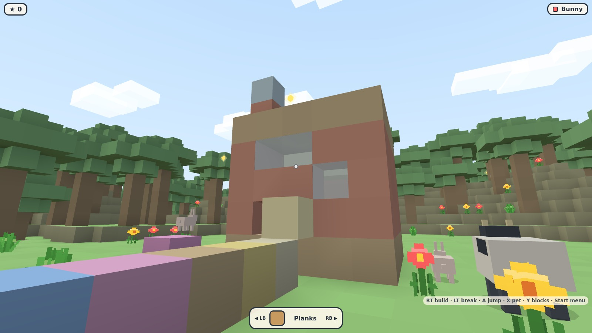
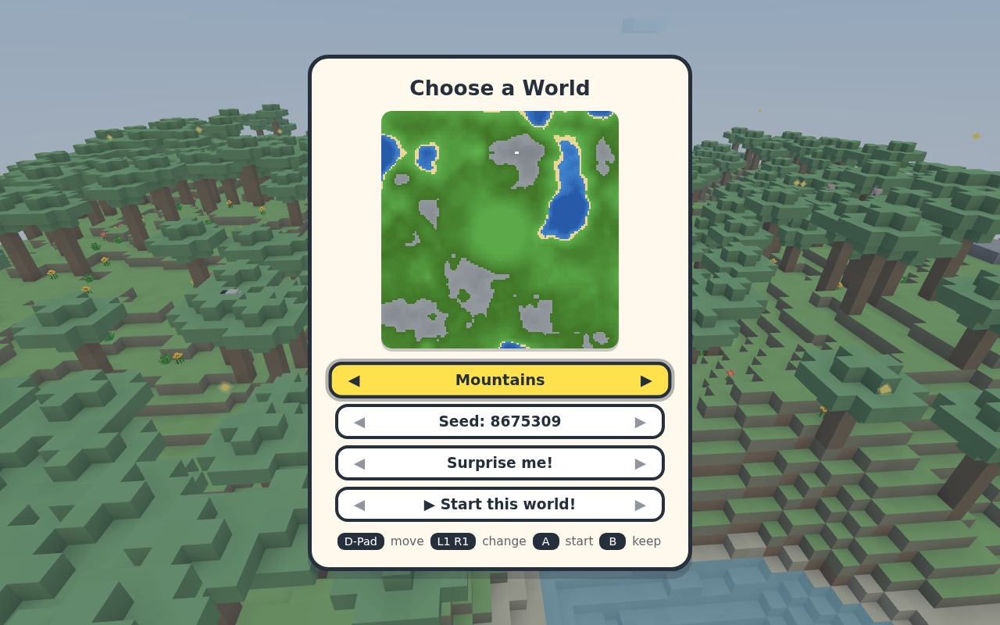
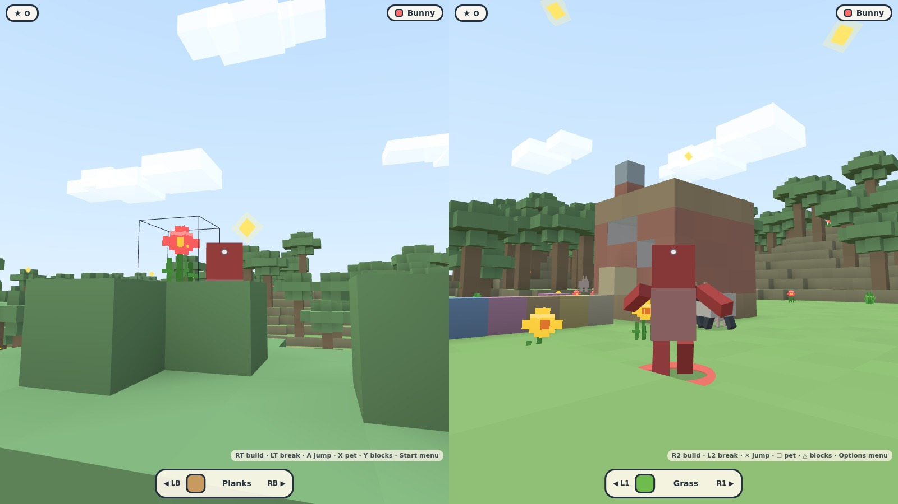
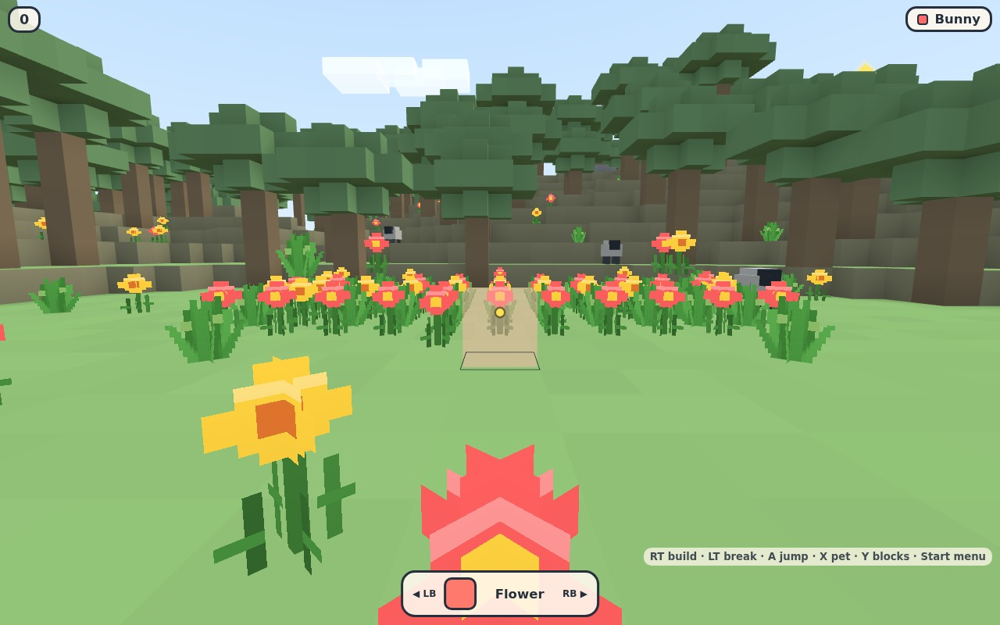
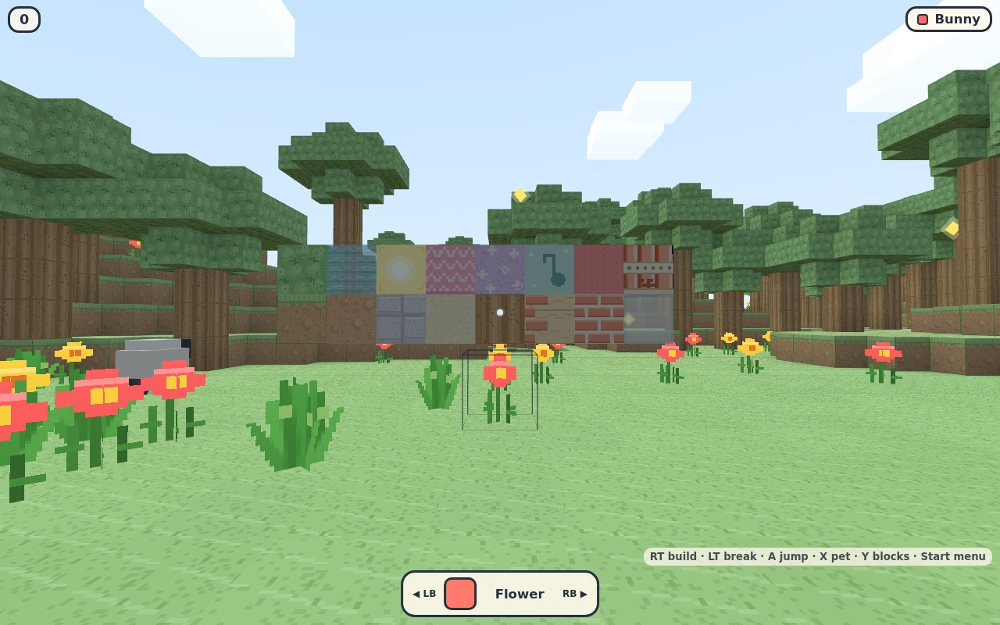
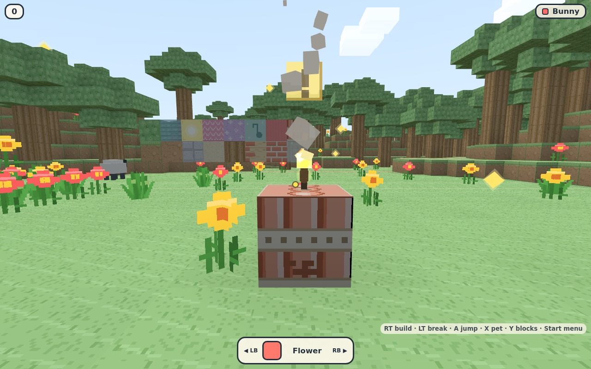

# 🧱 Elocraft



A colorful, controller-first voxel sandbox for kids — inspired by Minecraft
Creative mode, built for a 5-year-old and a parent on one couch.

- 🎮 **Play online right now:** <https://vesanieminen.github.io/Simplecraft/>
  (the repository is still named `Simplecraft`, its older name — same game)
  (in-browser save, see [How the world saves](#how-the-world-saves) — a split-screen
  couch session also works on one machine with two controllers plugged into it)
- No accounts, no internet needed after install, no external services.
- Two controllers on one computer = instant split screen (up to 4 players).
- A big world to explore: **128 × 128 × 64** blocks (four times the size of
  the first build), generated from a seed you choose.
- **Four worlds to pick from** at the start — Meadow, Islands, Mountains and
  Deep Forest — plus any seed, with a live map preview.
- A world that saves itself and survives restarts (one save per world).
- **Eight friendly animals** — sheep, bunnies, chickens, cows, and new
  pigs, horses, cats and foxes — each with a voice of its own.
- **Five kinds of fish** live in the lakes and the sea — minnows and sunfish
  travel in moving schools, and the golden fish is a rare glittering sight.
- **🎣 Fishing** — aim at the water, press the pet button, and when the
  bobber dives, press again for a fish (see *Fishing* below).
- **🎒 A fish satchel** — every catch waits in the kid's pouch (see the 🐟
  chip on the HUD) until they eat it from *Menu → Satchel* for a tasty boost.
- **Doors you can open, proper stairs, treasure chests hidden in every world,
  slabs, saplings that grow into trees** — and planks that finally look like
  planks.
- Glowing stars to collect, bouncy blocks, musical blocks, and a world
  full of textured flowers, grass tufts, lakes, and trees.

## Choosing your world



Before anybody joins, press **Y / △** on a controller (or **F** on the
keyboard) to open the world chooser:

- 🌍 **World** — Meadow · Islands · Mountains · Deep Forest (left/right).
- 🎲 **Seed** — step it up and down, or hit **✨ Surprise me!** for a random one.
- The picture above is drawn from the same heightmap math the generator uses,
  so what you see is what you get.
- **▶ Start this world!** — every (world, seed) pair is saved separately, so
  each family member can keep their own builds.
- Grown-ups can also switch worlds mid-game from *Start → Grown-Ups → Choose
  World*, and the URL takes both: `?seed=12345&world=2`
  (`world` = 0 Meadow, 1 Islands, 2 Mountains, 3 Deep Forest).

## Fishing 🎣

Any lake, pond or flooded sandpit will do: stand on the shore, **aim at the
water** and press the pet button (**X / ☐**, or **E** on the keyboard) — your
kid swings a little rod and a bobber arcs out and plops onto the surface. A
moment later something bites: the bobber dives and plops, so press the pet
button *again*. Too early and the hook comes up empty; too late and the fish
gets away.

- What bites mostly lives where you are fishing. **Minnows and sunfish
  travel in schools** that drift through the water together; puffers and
  bass prowl alone; the **golden fish** is rare and worth a fistful of stars.
- Every fish is worth stars with a splash and a fanfare — and then it goes
  into your **satchel** 🎒. The 🐟 chip under your name counts the catch, and
  *Menu → Satchel* lists it: pick a fish and eat it for a tasty boost.
  Minnows and puffers make your legs **boingy** 🦘, sunfish and bass make
  your feet **zoomy** 🌈, and a golden fish does both at once.
- The fish are shy — paddle up to a school and the whole flock darts away.
  Blasting a pond dry is not the way to catch lunch either: the fish rescue
  themselves to the nearest water and new ones drift in over time.

## My Worlds (saved games)

Because every world autosaves, the game keeps a list of them all:
**💾 My Worlds** — from *Start → Grown-Ups → My Worlds*, or *📚 My saved
worlds* inside the world chooser at the welcome screen.

- Every world you have ever played is listed, most recent first, with a map
  preview, the world theme, the seed, how many blocks are saved, and how long
  ago you last played.
- Highlight a world and press **A** to move the whole family into it — the
  builds come back exactly as you left them, saplings keep growing and lit
  dynamite keeps burning. Players start at the world's spawn point.
- 💾 **Save this world now** for grown-ups who want the belt *and* braces
  (autosave already fires a second after any change).
- 🗑 **Delete**: highlight a world and press **Y / △** (or **F**) — the row
  answers **SURE?** and a second press wipes that world for good. Moving the
  cursor away cancels; nothing else can be deleted by mistake.
- On the GitHub Pages site this list comes from that browser's storage; on
  the home server it comes from the server (plus anything you saved while it
  was briefly asleep).

## Launch

```bash
npm install
npm run dev
```

Then open **http://localhost:3000** — that's it. The terminal prints the
exact address to use from other computers.

Production mode (faster):

```bash
npm run build
npm start
```

## Playing together

### Two controllers, one computer (split screen)



1. Plug in two controllers (Xbox, PlayStation, or any standard pad).
2. Open the game in a browser. (Optional: press **Y / △** first to pick a
   world — see [Choosing your world](#choosing-your-world).)
3. **Player 1 presses any button** on their controller → pick a color, name
   and **costume** (**LB/RB** on the join card cycles Kid, Astronaut, Robot,
   Wizard, Dino, Cat and Knight) → press **A / ✕** to join.
4. **Player 2 presses any button** on the *other* controller → join card
   appears in a new half of the screen → confirm.
5. Split screen activates automatically. Side-by-side on wide screens,
   top/bottom on tall ones (change it in Grown-Up Settings).

Up to **four players** can join on one computer (2×2 grid). Just press a
button on each additional controller. You can also mix: player 1 on
keyboard + player 2 on a controller.

### Someone is finished playing

- **Start → 🚪 Leave** (press **A** twice — kids press everything, so it asks):
  that player goes home, *their part of the split screen closes* and the others
  get the space back. Their builds stay in the world.
- Press any button on that controller a moment later and a fresh join card
  appears, so a sibling can take the seat over.
- If the **last** player leaves, the welcome screen comes back.
- A controller that merely *falls asleep* keeps its seat and shows a wake-up
  card. A grown-up can clear those with
  *Start → 🧑 Grown-Ups → 💤 Waiting Players* (two presses again) — the
  sleeping players go home and the screen closes up.

### Other computers on the home network (LAN)

The dev server binds to `0.0.0.0`, so other computers on the same Wi-Fi
can open the address the terminal prints, e.g. `http://192.168.1.50:3000`.
(Sharing one world across computers — true multiplayer sync — is the next
milestone; see Roadmap. Today, each computer gets the same saved world.)

## Controller controls

| Button | Action |
|---|---|
| Left stick | Walk / swim / fly sideways |
| Right stick | Look around / aim |
| A / ✕ | Jump (hold while flying = up) |
| LT / L2 | Place block |
| RT / R2 | Break block |
| LB / L1 | Previous block · previous costume on the join card |
| RB / R1 | Next block · next costume on the join card |
| X / ☐ | Pet animals · open/close doors (hold while flying = down) |
| Y / △ | Open the block palette (before anyone joins: choose a world) |
| D-pad | Navigate menus |
| Start / Options | Player menu (fly, camera, **costume**, home, help…) |
| B / ◯ | **Crouch** (sneak: slow, squat, never walks off ledges — tap again to stand) · Back / close in menus |

Everything is doable with a controller only — joining, palettes, menus,
settings, help, everything. The block palette is a real grid: **left/right**
step through blocks and **up/down** jump a whole row, so finding the one you
want is four presses, not twenty.

## Keyboard & mouse (optional)

WASD move · arrow keys look · Space jump · Ctrl crouch · RMB place · LMB break ·
Q/R cycle blocks · F palette · E pet animals / open doors · Esc menu · Enter confirm.

*(The build/break buttons were swapped in November 2026 — kids build far
more than they dig, so the comfy left trigger / right mouse button now
builds. The Grown-Ups cannot turn this back; muscle memory will follow.)*

## Flowers you can actually pick



Flowers, sunflowers and grass tufts are real textured plants: each one is a
pair of crossed quads painted from a procedural 32-px atlas (drawn in code,
still no image files). They sway in with the world, you walk straight through
them — and **RT / R2 breaks them**, because the break button also targets
things that aren't solid. Water sources and bedrock stay indestructible
(travelling water can be broken — see the water section), and plants
never get in the way when you place a block (the two aim at slightly
different things so both just work).

## Doors, slabs, stairs and saplings 🚪

New in the palette (Y / △), right next to the planks they're built from:

- **🚪 Door** — **two blocks high and half a block thick**, painted like a
  real door: two panels below, a tall panel with a little window above,
  hinges on one side and a brass knob at hand height. One press of the build
  trigger puts the whole thing in — no stacking blocks to size it. Press
  **X / ☐ / E** while looking at any part of it and the whole door swings
  open with a wooden creak: closed it keeps the rain (and cows) out, open
  it's a thin standing panel you walk straight through. Break any half and
  the whole door comes down. It stands the way you placed it, and it
  *remembers* which way it opens across saves and restarts.
- **⬛ Slab** — a flat wooden plate exactly **half a block tall**: walk into it
  from any side and you step up onto it, no jumping. Two stacked are a full
  block, a ring of them is a kerb, a shelf or a low garden wall. (Naming
  confession: this is the block the palette used to call *Stairs*. It is now
  called what it always was — and the real stairs below are new. Old worlds
  keep their plates exactly as they built them; they are simply labelled
  **Slab** now.)
- **🪜 Stairs** — a **proper step**: one half of the cell is a half-high tread,
  the other half is full height. Build one and it points *away* from you, so
  its riser leans against the wall you were aiming at and the step climbs away
  from where you are standing. Walk up the tread side and you climb a **whole
  block** without ever touching the jump button — tread, riser, tread. Put the
  next one one block over and one block up and you walk straight up a whole
  staircase, half a block per step: four steps is a door-step, eight is a wall.
  Walking into the back of a step is a real climb (jump, or spin it round),
  because a step has a front. If it landed the wrong way round, aim at it and press
  **X / ☐ / E**: it spins a quarter turn on the spot. Each step remembers which
  way it points, across saves and restarts.
- **🌳 Sapling** — plant one on clear ground, run off to build something,
  and about half a minute later it grows into a full tree — trunk, leaves
  and all, with a little sparkle and a toast. Saplings you leave behind
  keep growing the next time you join. (Chop the tree, plant the next one.)

And the wood shelf is complete: **logs** with bark sides and growth-ring
ends, **planks**, and **leaves** were already in the palette — now the whole
tree, from sapling to plank, is buildable by hand.

## Treasure chests 📦

Every world hides **twelve treasure chests** out in the wild — never on the
starting meadow, always on dry ground with the sky above them, so the first
one is a walk rather than a step. They come out of the seed, so the same world
hides the same twelve treasures forever, and the hint ticker likes to nudge:
**🗝️ Find a treasure chest!**

A chest is a squat wooden box (0.85 of a block tall) painted with a brass lock,
an iron-banded lid seen from above and dark boards underneath. Look at one and
press **X / ☐ / E** — the same button that pets animals, swings doors and turns
stairs — and the lid comes up: gold particles, a jingle, and a toast telling
everybody on the couch what was inside. The treasure is rolled when the lid
lifts, and there is no inventory in this game, so the treasure is something
that *happens*:

- **⭐ A pile of stars** — four stars straight onto that player's counter.
- **🌟 Stars jumped out** — three real collectible stars pop out and hover over
  the chest until somebody grabs them.
- **🌈 Zoomy boots** — run half again as fast for thirty seconds, with a
  **🌈 Zoomy!** badge on that player's HUD while it lasts.
- **🦘 Boing boots** — mega jumps for thirty seconds (a **🦘 Boingy!** badge).
- **🐣 A surprise animal friend** — a random animal hops out of the chest and
  adopts that spot, voice included.
- **💎 A GIANT diamond** — twenty-five stars, and by far the rarest find.

An opened chest **stays opened** (it is drawn with its lid up and its gold
showing): press the button again and it tells you the treasure is already
yours, so nobody shakes the same chest twice. Chests are also in the block
palette, so children can hide their own — and one chest per (world, seed) pair
is a fair game of hide and seek.

## The whole barnyard 🐷

The meadow used to have sheep, bunnies, chickens and cows. Now there are
**eight kinds**, all box-built, all wandering, all harmless, all petable
with **X / ☐** (they hop and say hello):

- **🐷 Pig** — pink, flat snout, curly tail; goes *oink oink*.
- **🐴 Horse** — tall, brown, dark mane and tail, white blaze; a proper
  sliding whinny.
- **🐱 Cat** — orange, white chest, tail standing straight up; meows.
- **🦊 Fox** — dark-tipped ears and a big white-tipped tail; yips twice.

Roughly thirty animals live in each world. The kind list is dealt out
round-robin so every meadow really gets the full zoo, and the shy critters
(foxes, horses) stay rarer than the farm regulars. Every voice is
synthesized in code, like every pixel.

## Everything is painted, blocks and kids alike



There are no flat-coloured cubes in Elocraft: every block is drawn
into one procedural 32-px atlas at startup — grass with a fringe over dirt,
dirt clods, stone boulders with cracks, sand grain, bark and growth rings on
log ends, planks with real board gaps, staggered joints and nail heads,
offset bricks over mortar, leaves with twigs, water with waves, the glow-block
sun, bouncy springs, sparkle stars, a music
note, bedrock boulders, scorched crater rims, painted doors, treasure chests
(lock, lid, gold inside) and the dynamite
bundle. The
eight candy colours keep their own bright tint and multiply a near-white
weave through it, so a Red block still reads as Red — it just looks like
painted building brick instead of solid plastic. Glass and water are painted
too, through the same see-through material.

The children are dressed the same way: a knitted jumper (collar, a stitched
pocket and two buttons on the front), denim trousers with a seam down the
leg, and the same little face as always. All of it is near-white weave, so
each player's chosen colour tints straight through — Strawberry stays
Strawberry, it is just knitted now.

Still no image files: every pixel above is drawn in code, exactly like the
flowers and the sky.

## Swimming — and how to get out

Lakes, rivers and the Islands world are properly swimmable: you bob at the
surface, paddle with the move stick and hold **A / ✕** to kick upward. Once
your head is clear of the water, that same button *pushes you out* — a real
jump, so you hop onto the bank or the rim of a pool instead of paddling in
circles. Fully submerged, kick up to the surface first. If a bank is more than
a block above the water, place a block or dig a step to make a stair.

## Water flows 💧

Water now behaves like the big game. The sea is made of **source** blocks:
eternal, and unbreakable — you will never drain the ocean or fall through it.
But dig into the shore and the sea **flows in**: water pours straight down at
full depth, spreads sideways one cell per tick getting one step shallower as
it goes, and stops dead six cells from any source. A channel you dig into a
pond fills up visibly, cell by cell, and a waterfall keeps its depth all the
way down the cliff.

- **Flowing water is real shallow water.** Each travelling cell remembers how
  deep its supply is and is drawn that shallow — a puddle, a knee-deep sheet,
  a full block by the source. Pools read as one body of water, not a stack of
  boxes.
- **Break the flow to fight a flood.** Travelling water *can* be broken with
  RT / R2: scoop a gap across your trench and everything beyond it loses its
  chain to a source and dries up, cell by cell. Or just fill the trench with
  blocks. Sources never break.
- **Water is in the palette now.** Place a source and give your fort a moat —
  that source is eternal too, so plan the moat before you dig it.
- Sand sinks through it (and the displaced water rides up), flowers get
  washed over, and a fresh world's sea sits perfectly still until somebody
  changes something under it.

## Dynamite 🧨



Dynamite sits in the block palette **and** on the shoulder-button favourites,
so a five-year-old finds it in two presses. Set one down and **it lights
immediately**: the fuse spits sparks and shrinks, the stick rattles, a chunky
yellow "!" bobs over it, and it hisses — the ticks get faster and louder until
it goes **BOOM** about two and a half seconds later. You *hear* the fuse
running out, so children learn to run clear without anyone having to tell them.

- **The blast really moves the world.** A sphere about three and a half blocks
  across of dirt, stone, wood, bricks, glass and plants is carved out, chunky
  debris flies off in the colours of whatever went, smoke drifts up, the sky
  flashes and the crater rim stays scorched. Bedrock and water always win, so
  the floor never collapses under anybody.
- **Everybody is fine.** Players and animals are launched into the air,
  completely unharmed, and land on their feet — a cartoon tumble, no health
  bar, no game over. The screen gives one warm little punch and each nearby
  camera shakes, so the kick is felt as well as seen.
- **Chain reactions.** Sticks near a blast catch light too, so a line of them
  goes off one after another.
- **Hitting a burning stick with RT / R2 does not take it off** — you bonk the
  stub and it pops almost at once, which is the fun way to hurry one along.
- Sticks are ordinary blocks: they live in the save, other blasts can carve
  them away, and one you left lying around is still burning when you come
  back. **Reset World** in the Grown-Ups menu (or a fresh world) tidies the
  mess, and every block a blast removed is undone the same way.

## How the world saves

- **On the GitHub Pages site** the game runs entirely in your browser: the
  world is saved in that browser's local storage (per computer, per
  browser). Great for playing instantly; for a shared family world, run
  the game from a computer at home as below.
- The terrain you start with is generated from a **seed + world theme**
  (default `20261102`, Meadow). Only player edits (blocks placed/removed,
  stars collected, and — since save **version 2** — doors and the way each
  one swings) are stored — a few KB, not the whole world.
- Grown-Up settings that belong to the whole browser — the **split-screen
  layout** and **sound on/off** — keep their own small `lbw-settings` key
  and come back after any reload. (Freeze is deliberately *not* remembered:
  the world always wakes up alive.)
- Edits are saved through the local server to
  `world-data/world-<seed>-<world>.json` (atomic write + backup + corruption
  recovery), with a browser-cache fallback if the server is briefly
  unreachable. Each world you choose gets its own file, so nobody overwrites
  anybody else's house. `GET /api/world/list` returns the saved worlds (seed,
  theme, last saved, edit count) for the My Worlds menu; a small
  `lbw-world-index` localStorage key does the same job when there is no
  server.
- Restart the server any time; your buildings are still there.
- **Reset the world** deliberately from *Start → Grown-Ups → Reset World*
  (asks twice).
- Grown-Up Settings (Start → 🧑 Grown-Ups) also has **Freeze Game** — the
  whole world stops dead, animals and players included, so a parent can
  pause the adventure — **Choose World** to move the family to a new
  world/theme/seed mid-game, **My Worlds** to play an old saved world again,
  and the **Split Screen** switch
  (Smart · Left/Right · Up/Down · 2×2 Grid).
- Use a different world per family with `?seed=12345&world=1` in the URL
  (each world + seed gets its own saved edits).

## Troubleshooting

- **Controller not detected** — browsers only expose gamepads after a
  button press and usually need one "activation": click the page once,
  press a button. Chrome/Edge/Steam Link work best. Firefox works but
  may need `gamepad.enabled`.
- **Both players joined with one controller** — press the *other*
  controller's button *first*; each controller is bound to whoever
  pressed it. A disconnected controller keeps its player's seat warm:
  press any button on it (or any new pad) to resume the same character.
- **Mouse cursor steals focus** — keyboard player 1 uses Esc for menus;
  game keeps running for everyone else.
- **Block won't place** — you can never place a block inside yourself or
  an animal (you'd get stuck); back up half a step.
- **Paddling in circles in the water** — hold the jump button: at the surface
  it pushes you out onto the bank. If the bank is higher than that, place a
  block or dig a step to make a stair out.
- **Low framerate on an old laptop** — close other tabs; the renderer is
  capped at 1.5× pixel ratio; quarter (4-player) panes cost the most.

## Testing status (honest)

Automated (Playwright, real Chromium, 42 tests): game loads error-free,
keyboard-only join, controller join/move/jump/build/cycle, palette with
D-pad, per-player menu + fly toggle, split-screen activation, 2×2
four-player grid, independent movement, one player's palette not pausing
the other, resize re-layout, controller disconnect/resume UI, and world
persistence across a server-backed reload. Plants render
from the textured atlas and **RT breaks them** (while water and bedrock
refuse to break and plants never block placement), the Grown-Up menu items
really work (Freeze stops the whole world dead, split-screen layouts cycle
through Smart/Left-Right/Up-Down/2×2, Reset World wipes edits, Choose World
starts a new theme+seed and the preview canvas actually paints a map), the
welcome-screen world picker (theme, surprise seed, start), menu
sub-screens receiving controller input, `?seed=…&world=…` handling, and
walking into a pond then **hopping back out** with the jump button held; a
player **leaving** so their half of the split screen really closes (pane, HUD
and card removed, the others go full screen, the freed controller can invite a
new player, and the welcome screen returns when the last one leaves), plus
clearing controller-asleep players from Grown-Up Settings. Dynamite is covered
too: placing a stick lights it, the blast carves a crater and scorches the rim
while bedrock and water shrug it off and the fuse meshes are cleaned up, RT
re-lights a burning stick instead of removing it, one blast lights its
neighbours (chain reaction), and a stick you left in the world is still
there — still burning — after a reload. The new art is checked too: the
atlas is decoded in the page and every cell must be drawn and different from
all the others, painted blocks must really reach the textured mesh channels
(including see-through glass and water), and the avatars must be wearing
cloth, denim and a jumper front. And no black hole in the sky, from any angle.
And no see-through terrain around a squat block: hidden-face culling is only
allowed against a neighbour that really fills its cell, which is why the walls
around a treasure chest (0.85 of a cell tall) keep their faces — a regression
this round, counted quad by quad in one chunk.
New this round: a **two-block-high, half-a-block-deep door** gets built with
one press of the build trigger, stops a walking kid right at the panel (not
half a block short of it), swings open under the pet button, lets them walk
through, closes from the other side, comes down as a whole door when any half
is broken, and reappears after a reload from the save with its swing;
the **block palette** really walks its grid — left/right step cells, up/down
jump whole rows and wrap; **releasing the mouse button stops building** (the
endless auto-placing bug: the swap left `mouseup` on the old mapping, so a
released right button stayed held forever); **slabs** (the half-plate the
palette used to call *Stairs*) step you up automatically from every side; real
**stairs** point away from whoever builds them, walk you up a whole block with
the jump button never touched, stop you at the back riser, spin a quarter turn
under the pet button, and keep the way they point across a reload (saves are
now **version 3**, which carries `stairFacing`); **treasure chests** hide
twelve per generated world, the pet button lifts the lid, one of six random
treasures really changes the world (stars on the counter, stars hovering over
the chest, a speed or jump boost, a new animal friend), an opened chest pays
out nothing twice and stays open after a reload; a planted sapling grows
into a recorded full tree; **first person** hides a body from its own camera
via three.js layers while every other camera keeps seeing it; the 10-row
player menu really **fits inside a half-height stacked pane**; grown-up
layout + sound settings come back from `lbw-settings` after a reload; and
all **eight animal kinds** live in every meadow.

```bash
npm test          # e2e suite (starts its own server on :3100)
npm run typecheck
```

**Physical controllers: tested on real hardware.** The family played it with an
**Xbox One** pad and a **PS5 DualSense** — both worked fine: joining, both
sticks, building, palette, menus, split screen and waking a sleeping
controller. The items below are what to re-check after any input change; the
**swapped LT/RT build/break mapping**, the new **door / slab / stairs /
sapling** blocks, the **treasure chests** (**X** opens a lid, and a boost
badge appears on the HUD), the **first-person visibility fix**, the **Leave /
Waiting
Players** rows, and the new **My Worlds** saved-game list all still owe the
couch a turn. Virtual pads in the automated tests drive
the exact same input abstraction (dead zones, edge detection, button mapping
all shared) — a good regression net, still not a substitute for hardware QA.

1. Press **Y / △** on a pad at the welcome screen → the world chooser opens
   on that pad: D-pad moves, left/right switch world and seed, **✨ Surprise
   me!** rolls a seed, **A** starts that world. The map picture should match
   the world you end up in.
2. Press A on each pad → two join cards appear. In a card: D-pad changes
   name/color, A joins, B cancels.
3. Right stick looks around on both pads simultaneously.
4. **LT places / RT breaks** (the November 2026 swap — check both pads
   really follow the new mapping); LB/RB cycle; Y opens the palette;
   D-pad + A picks a block while the other kid keeps running around.
5. Walk up to a flower and hold **RT** — it pops into particles (and the
   block behind it survives, so you can also dig the ground under it).
   Walk up to a sheep and tap **X** — it hops and beeps.
5b. Place a **door**: it should stand two blocks high out of one press, half
   a block thick. Look at it (any half) and tap **X**: the whole door swings
   open with a creak, walk through, tap X from the other side to close it.
   Break the top half: the whole door comes down. Place a **slab**: you step up
   onto the flat plate from any side, no jumping. Place **stairs**: they should
   point *away* from you (riser against whatever you were aiming at); walk up
   the tread side and you climb a whole block without jumping, walk into the
   back and you stop at the riser; aim at one and tap **X** and it turns a
   quarter turn. Find (or place) a **treasure chest** and tap **X**: the lid
   comes up, a toast names the treasure, and a boost (if you drew Zoomy or
   Boing boots) shows a badge on that player's HUD — tap X again and the chest
   says it is empty. Plant a **sapling**, wait a moment:
   a tree. In the **block palette**, check the D-pad really goes up/down as
   well as left/right. Check all of this on the pad, not just in the
   automated tests, and build/break a few times with the swapped triggers.
6. Walk into a lake and hold **A** — you kick up to the surface, then hop out
   onto the bank instead of paddling in circles (works from the Islands sea too).
7. Start menu → Fly ON → A rises, X descends, gentle landing.
8. Start → Grown-Ups: **Freeze Game** stops players *and* animals dead
   (menus still work), **Split Screen** cycles the layout, **Choose World**
   opens the picker, **Reset World** asks twice. Open **💾 My Worlds**: the
   D-pad walks the saved-world list and the map picture follows the
   highlight, **A** on a world loads it, **Y / △** on a world asks once
   (**SURE?**) and deletes on the second press, and from the welcome
   screen's chooser **📚 My saved worlds** ↔ **🌍 New world…** swap
   back and forth.
9. Unplug a controller mid-game → "controller asleep" appears → plug in
   (or press another pad) → same character resumes.
10. Start → 🚪 **Leave** → press **A** twice: that half of the screen closes,
    the other player goes full screen, and the sleeping seat is cleared by
    Start → 🧑 Grown-Ups → 💤 **Waiting Players** (also two presses). A moment
    later, a button on the left controller should open a fresh join card.
11. Analog: gentle stick tilts walk slowly; menus don't machine-gun.

## Roadmap

Implemented: a 128 × 128 × 64 voxel world (four world themes + any seed,
picked on a screen with a live map preview), building, textured plants,
eight kinds of animals, doors, slabs, real stairs, treasure chests with random
treasure hidden in every world, saplings that grow into trees,
stars, special blocks, audio, particles, complete controller UX,
2–4 player split screen, per-world persistence with a saved-worlds menu, and
remembered grown-up settings.

Next (designed for): LAN multiplayer — the architecture already separates
*local player*, *remote player*, *controller*, *camera*, and *network
player*; the save API already merges concurrent writers, so Socket.IO
sync is the next step.

## Tech

TypeScript · Three.js · Vite · Node/Express (+ `ws` ready) · Playwright.
All art, models, and sounds are original and procedural — no Minecraft
assets. Original code, MIT-style for your family's fun.
